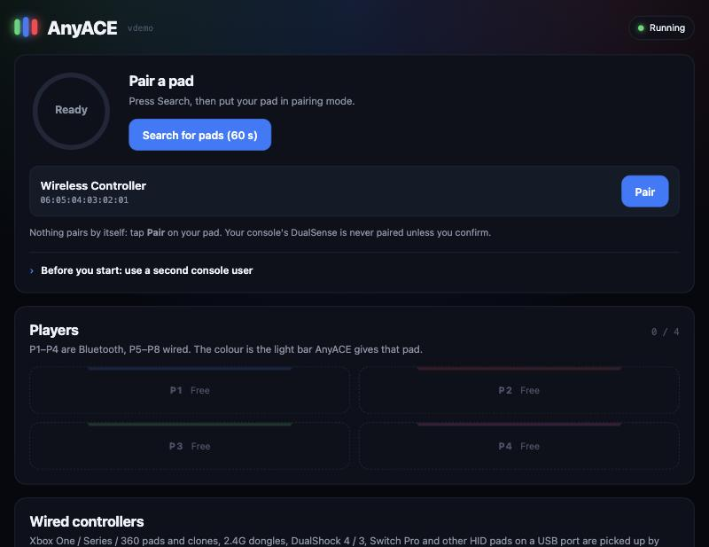
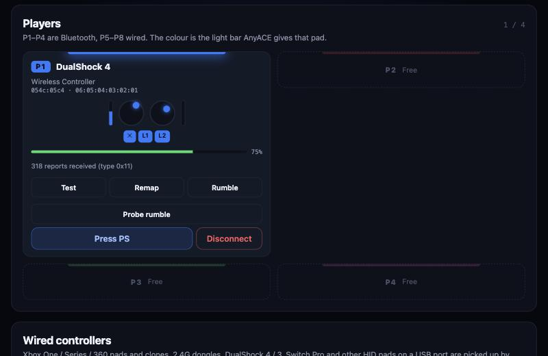
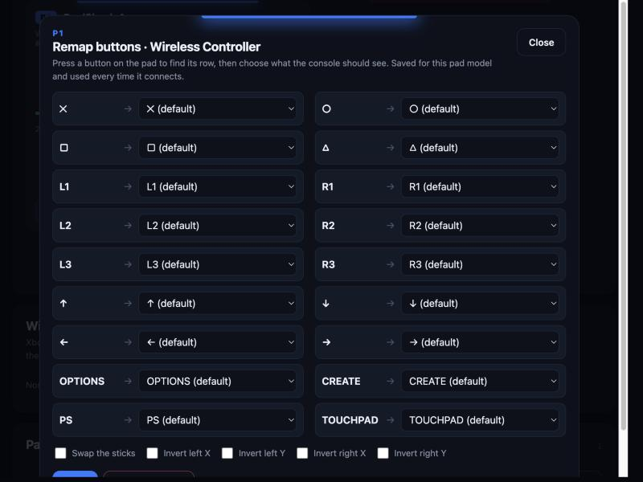
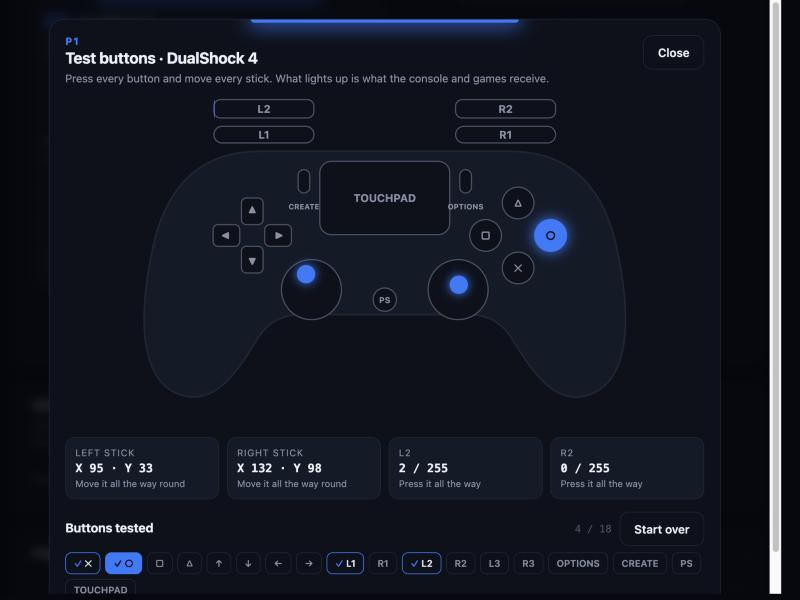

<p align="center"></p>

# AnyACE — any controller on a jailbroken PS5

AnyACE is a resident payload for a jailbroken PS5 that lets you play with
controllers the console does not accept on its own: DualShock 4, Xbox
(wired or Bluetooth), Nintendo Switch Pro, 8BitDo, and most other Bluetooth
or USB game pads. It drives the console's own Bluetooth chip and USB ports,
and presents every pad to the system and to games as a **virtual
DualSense**. No dongle, no game patches, no firmware changes.

It is a fork of [AnyPad-PS5](https://github.com/sinfiltros/AnyPad-PS5) by
sinfiltros, rebuilt with a pairing picker, a new web menu, remapping,
settings, wired USB pads of every kind, and many fixes verified on real
consoles. See [CHANGELOG.md](CHANGELOG.md) for everything that changed.

**Firmware:** 4.00 up to 13.60 (tested on 11.60 and 13.60; reported working from 4.00). **Status:** beta.

## What works

- **Bluetooth pads:** DualShock 4 (verified), 8BitDo SN30 Pro in Xbox and
  Switch modes (verified), ASUS ROG Raikiri Pro (verified), Switch Pro,
  Xbox One/Series over Bluetooth, DualSense, and any other Bluetooth HID
  gamepad through its own descriptor. [COMPATIBILITY.md](COMPATIBILITY.md)
  lists them one by one.
- **Wired pads on the console's USB ports**, picked up by themselves:
  Xbox One / Series pads and clones (verified), Xbox 360 pads and the 2.4 GHz
  dongles that imitate one, the Xbox 360 wireless receiver, DualShock 4 and
  DualShock 3, Switch Pro over USB, and any other USB HID gamepad.
- **Up to 8 pads:** four Bluetooth (P1–P4) and four wired (P5–P8).
- **A web menu** on your phone or the console's browser: pair, see every
  pad live, test buttons, remap buttons, test rumble, settings, the log.
- **Remapping per pad**, saved on the console and applied every time that
  pad connects.
- **Battery level** for pads that report it.
- **Your DualSense is protected:** AnyACE never pairs a pad by itself, and
  refuses a DualSense unless you insist.

## What does not work yet

- **Rumble from games.** Every pad can be rumbled from the menu (Test
  rumble), but the console offers no documented way for a virtual pad to
  receive what a game asks of it. An experiment is under way (the *Probe
  rumble* button); see the changelog.
- **Firmware 13.60:** the Media-row tile cannot be installed (the system
  call is gone), so open the menu from a browser; and the Bluetooth chip
  reports no Bluetooth LE advertisements there, so LE pads (Xbox Series over
  Bluetooth, some pads' Bluetooth mode) cannot be paired on 13.60. Classic
  Bluetooth pads and wired pads work.
- Motion and touchpad are passed only for pads that have them (DualShock 4,
  Switch Pro).

## Install

1. Download `AnyACE-PS5-<version>.elf` from the
   [Releases](../../releases) page.
2. Send it to your console's payload loader (port 9021 with the usual
   jailbreak chain), or copy it to a USB drive and import it into Payload
   Manager. It can be added to your autoload list.
3. A notification shows the menu address, for example
   `http://192.168.1.50:8095`. Open it on your phone, a PC on the same
   network, or the console's browser. On firmware up to 13.4x an **AnyACE**
   tile also appears in the console's *Media* row and opens the menu.

Do not run AnyACE together with OmniPad-PS5 (another fork of the same
code): it shares AnyACE's state folder and stops AnyACE when it starts.

## Use

### 1. Create a second console user (once)

Games only take a pad from the user who owns it, and your DualSense's user
already has one. So:

1. On the console, **Settings → Users and Accounts → add a new user**. Name
   it after the pad ("PS4", "Xbox"…) so you always know which is which.
2. When a pad connects, the console asks **"who is using this
   controller?"** — choose that new user.
3. Play with your own main user. Tap **PS** on the pad (or **Press PS** in
   the menu, for pads without a PS button) to make it the active pad.

The menu's *Settings* section can press PS for you automatically, and can
assign every pad to a chosen user.

### 2. Pair a Bluetooth pad



1. In the menu, press **Search for pads (60 s)**.
2. Put the pad in pairing mode (DualShock 4: hold *Share + PS* until the
   light bar flashes fast; Switch Pro: hold the small *Sync* button; Xbox:
   hold the *Pair* button; 8BitDo: see its manual).
3. The pad appears in the list with its name. Tap **Pair** on it.
4. Choose the second user when the console asks. Done: the pad reconnects
   by itself whenever you switch it on.

If the pad found is a DualSense, it is marked and only paired after a
confirmation, so your console's own pad is never taken by accident.

### 3. Plug in a wired pad

Nothing to do: plug it into a USB port of the console. It appears under
**Wired controllers** within a few seconds and gets a player slot (P5–P8)
as soon as you press something.

### 4. The player cards



Every connected pad has a card with its live sticks, triggers and buttons,
battery, and these buttons:

| Button | What it does |
|---|---|
| **Test** | A full-size pad that lights up every button, stick and trigger as the console receives them, with a checklist. |
| **Remap** | Change what each button does, swap the sticks, invert axes (below). |
| **Rumble** | Both motors for a moment, to check the pad's rumble works. |
| **Press PS** | The same as holding PS on the pad, for pads that have no PS button. |
| **Disconnect** | Drops the Bluetooth link; the pad stays paired. |

If the console did not give the pad to a user, the card says so and offers
**Retry binding**.

### 5. Remap a pad



Press a button on the pad and its row lights up; choose what the console
should see (any button, or nothing). *Swap the sticks* and *Invert …* are
below. **Save** applies at once and is remembered for that pad model, in
`/data/anypad/remap/`. **Back to default** forgets it.

### 6. Test the buttons



### 7. Settings

- **When a pad connects:** do nothing, or press PS automatically.
- **Give pads to:** the console's choice, or a signed-in user by name.

Both are saved on the console (`/data/anypad/settings.txt`).

### Paired pads

The list of every pad you paired, with **Forget**. A forgotten pad has to
be paired again.

### Log

**Show log** at the bottom of the menu shows what AnyACE is doing; **Clear
log** empties it. When something does not work, this log is what to send
along with a report. It is also at `http://<console>:8095/api/log`.

## Troubleshooting

- **The pad is connected but games ignore it.** Make sure it was given to
  the second user (the card says "Not reaching the console…" otherwise, with
  a Retry button), then tap PS on it.
- **A pad will not pair.** Switch it fully off, put it in pairing mode again,
  search again. The card says why the last attempt failed (no answer, the
  pad kept connecting to the console by itself, the chip refused the
  connection).
- **My DualSense stopped working with the console.** Reset it (the small hole
  on the back, ~5 s with a paper clip) and connect it with a USB-C cable.
  Forget it in AnyACE's paired list if it is there.
- **A wired pad does nothing.** Look at *Wired controllers*: "Detected,
  starting…" means it was recognised; the log says which protocol it was
  taken for. Xbox 360 pads over Bluetooth are not supported (they have no
  Bluetooth); over USB they are.
- **Rest mode.** AnyACE stops when the console goes to rest mode. Launch it
  again after waking up (or put it in your autoload).

## Build it yourself

Host tests (no console needed) on macOS or Linux:

```bash
make test && make fuzz
```

The console payload needs the [ps5-payload-sdk](https://github.com/ps5-payload-dev/sdk)
(release zip, unpacked) and Docker:

```bash
tools/build-elf-docker.sh /path/to/ps5-payload-sdk
```

The ELF lands in `dist/AnyACE-PS5-<version>.elf` with a `.sha256` beside
it. `make send PS5_HOST=<ip>` sends it to the console's loader.

The code is plain C11. `src/host.c` and `src/le.c` are the Bluetooth stack
(Classic and LE, on the console's chip, beside the system's own driver),
`src/profiles.c` and `src/generic.c` understand each pad, `src/usb_pads.c`
the wired ones, `src/ps5_vpad.c` the virtual DualSense, `src/web.c` and
`web/index.html` the menu. Every parser is fuzzed under the sanitizers.

## Credits and license

- [AnyPad-PS5](https://github.com/sinfiltros/AnyPad-PS5) by sinfiltros: the
  project this is built on, and the Bluetooth stack.
- [FGG-XSense](https://github.com/FGGstore/FGG-XSense) by FGG STORE: the
  wired Xbox (GIP) support began as a port of it.
- [OmniPad-PS5](https://github.com/diegobarbosaa/OmniPad-PS5) by Diego
  Lima: pointed the way to the wired pads worth supporting and the 2.4 GHz
  dongles' wake-up.
- Nicolas8aa, for finding why payloads did not start on firmware 13.60.
- The Linux kernel's xpad, hid-sony and hid-nintendo drivers, for the
  protocol details of the wired pads.

GPL-3.0-or-later. See [LICENSE](LICENSE).
